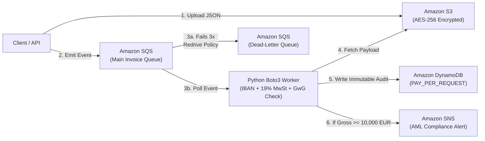

# Event-Driven SEPA Invoice & AML Compliance Pipeline (AWS Emulator + Terraform + DevSecOps)

[](https://github.com/Suman-Neupane/sepa-cloud-pipeline/actions/workflows/ci.yml)
[](#)
[-FF9900?logo=amazonaws&logoColor=white)](#)
[](#)
[-0052CC)](#)

An enterprise-grade, event-driven cloud-native pipeline designed for **German/EU FinTech compliance**. It processes incoming **SEPA invoices**, validates German IBANs (`DE...`) and **19% Mehrwertsteuer (MwSt / VAT)** calculations, enforces **German Anti-Money Laundering (Geldwäschegesetz - GwG)** reporting thresholds ($\ge$ 10,000 EUR), and isolates poison-pill messages via **Amazon SQS Dead-Letter Queues (DLQ)**.

To achieve **zero cloud costs (\$0.00)** and rapid shift-left feedback, the entire AWS infrastructure is provisioned via **Terraform** and tested end-to-end against the **Official AWS Emulator (`https://127.0.0.1:9297`)** both locally and on every GitHub Actions Pull Request.

---

## System Architecture



---

## Key Cloud & DevOps Engineering Highlights

1. **100% Infrastructure as Code (Terraform):**
   - Modular configuration in `terraform/` supporting seamless toggle (`var.use_emulator`) between local **Official AWS Emulator (`:9297`)** and live **AWS Frankfurt (`eu-central-1`)**.
   - **Security by Default:** S3 server-side encryption (`AES256`), S3 public access blocks, SQS managed SSE, DynamoDB point-in-time recovery, and **strict Least-Privilege IAM Policies** scoped to exact resource ARNs.
2. **Fault-Tolerant Event Processing & Chaos Testing:**
   - Configured SQS `redrive_policy` (`maxReceiveCount = 3`) linked to a dedicated **Dead-Letter Queue (`sepa-fintech-invoice-dlq`)**.
   - Automated chaos integration test verifying that corrupted/malformed invoices are automatically isolated in the DLQ after 3 failed attempts without blocking valid traffic.
3. **Shift-Left DevSecOps CI/CD Pipeline (`.github/workflows/ci.yml`):**
   - **Stage 1:** Runs `ruff` linting, fast unit tests, `terraform fmt -check`, `terraform validate`, and **Aqua Trivy IaC Security Scanning** to block high/critical misconfigurations.
   - **Stage 2:** Spins up the **Official AWS Emulator** container on port `9297`, executes `terraform apply -auto-approve`, and runs the full `pytest` end-to-end integration suite.

---

## Quick Start (Local Development)

### 1. Build & Start the Official AWS Emulator (Port `9297`)
```bash
make emulator-build
make emulator-up
```

### 2. Provision the AWS Infrastructure via Terraform
```bash
make tf-init
make tf-apply
```

### 3. Run Unit & End-to-End Integration Tests
```bash
# Fast unit tests (no Docker required)
make test-unit

# Full end-to-end S3 -> SQS -> DynamoDB -> SNS + DLQ Chaos tests
make test-e2e
```

### 4. Launch the Interactive Operations Dashboard (Web UI)
```bash
make ui
```
Open **[http://localhost:8000](http://localhost:8000)** in your browser to view the live AWS Emulator status, trigger 1-click invoice test simulations, inspect the SQS Dead-Letter Queue (DLQ), and monitor the DynamoDB compliance audit ledger in real-time!
